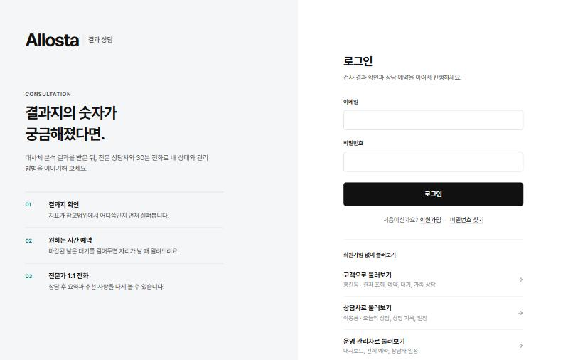
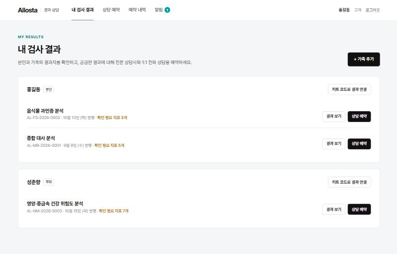
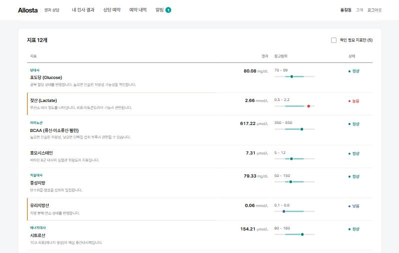
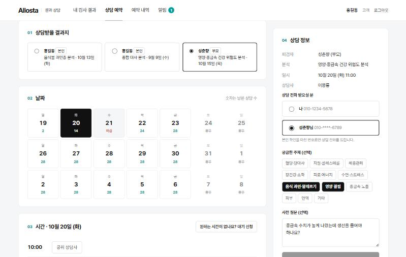
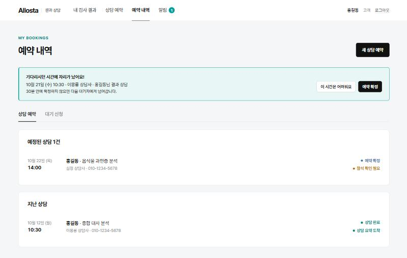
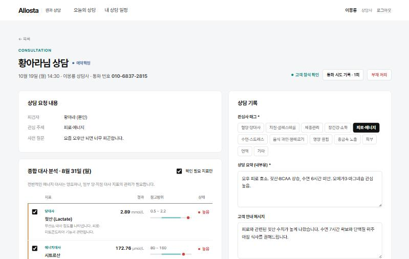
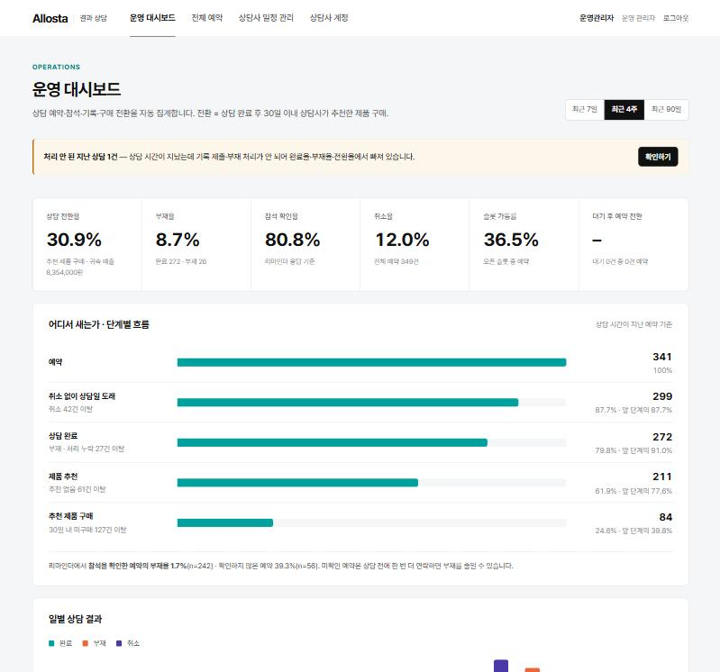
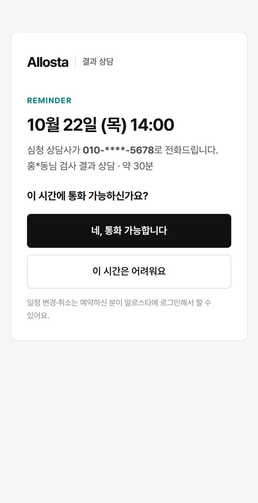

# 알로스타 검사 결과 기반 건강상담 운영 플랫폼

검사 결과지를 받은 고객이 **직접 상담을 예약**하고, 상담사는 **같은 형식으로 기록**하고, 운영팀은 **노쇼·전환율을 자동으로 확인**하는 상담 운영 플랫폼입니다.

> 핵심 문제 정의: 상담이 "예약 → 진행 → 기록 → 성과"로 이어지는 하나의 흐름으로 관리되지 않아, 각 단계에서 고객·시간·데이터가 새고 있다.

| 문제 상황 | 이 프로젝트의 해결 |
|---|---|
| 별도 채널로 연락해야 예약 가능 | 결과지에서 바로 셀프 예약, 날짜별 잔여 상담 수 캘린더 |
| 일정 겹침·예약 누락 | 단일 예약 원장 + **DB 부분 유니크 인덱스로 동시 요청까지 중복 예약 차단** |
| 원하는 시간이 마감되면 이탈 | 마감 시 **대안 시간 자동 제안** + **대기 신청 → 빈자리 생기면 1명에게 순차 제안·30분 선점** |
| 예약 후 당일 연락 두절 | 전날/1시간 전 **리마인더**, 문자 링크로 **로그인 없이 참석 응답**(가족 번호로 받아도 가능), 통화 번호 사전 지정, 통화 시도·부재 기록 |
| 상담사마다 기록 방식이 다름 | **구조화된 상담 기록**(관심사 태그·논의 지표·추천 제품+관심도·후속 조치), 제출 = 완료 |
| 관심 제품·구매 전환 수동 집계 | 자사몰 **주문 웹훅** 수집 → **30일 추천 제품 구매 귀속** → 대시보드 자동 집계, **단계별 이탈 흐름**(예약 → 완료 → 추천 → 구매)으로 어디서 새는지 표시 |
| 가족 결과로 상담 | 계정과 **피검자 분리**, **가족 본인 휴대폰 인증**을 마쳐야 가족으로 등록, 키트 접수 때 등록된 이름·생년월일·휴대폰과 일치해야 결과 연결, 통화 받을 사람 선택 |

## 바로 보기

- **공개 데모**: **https://allostar-consult.onrender.com** (Render 무료 플랜이라 15분 넘게 접속이 없으면 잠들어, 첫 화면까지 30초~1분 걸립니다)
- 로그인 화면의 **"회원가입 없이 둘러보기"**에서 고객 / 상담사 / 운영 관리자로 바로 들어갈 수 있습니다. 데이터는 모두 가상이고 서버가 다시 켜질 때마다(잠들었다 깨어날 때 포함) 오늘 날짜 기준으로 새로 만들어집니다. 그래서 다른 사람이 바꾼 내용도 다음 재시작 때 원래대로 돌아옵니다.
- 직접 실행하려면 [실행 방법](#실행-방법) (Docker 명령 한 줄)

## 화면

| | |
|---|---|
| <br>**로그인** · 회원가입·비밀번호 찾기, 데모 계정 바로 입장 | <br>**내 검사 결과** · 본인·가족 결과지, 가족은 휴대폰 인증 후 등록 |
| <br>**결과지 상세** · 지표별 참고범위 대비 위치, 확인 필요 지표 표시 | <br>**상담 예약** · 날짜별 남은 수, 시간별 상담사, 인증된 번호 중 선택 |
| <br>**대기 → 자리 제안** · 빈자리가 나면 1명에게 30분 선점 제안 | <br>**상담사 상담 화면** · 결과지·사전 질문 옆에서 구조화 기록 |
| <br>**운영 대시보드** · 지표, 단계별 이탈 흐름, 참석 확인 효과 | <br>**문자 링크 참석 응답(모바일)** · 로그인 없이 통화 가능/어려워요 |

> 화면의 인물(홍길동·성춘향·이몽룡 등)과 수치는 모두 **실행 시점 기준으로 랜덤 생성한 가상 데이터**입니다.

## 제출물 목차

| # | 항목 | 위치 |
|---|---|---|
| 1 | 문제 정의 및 요구사항 분석 | [docs/01-problem-and-requirements.md §1](docs/01-problem-and-requirements.md) |
| 2 | 도출한 전체 요구사항 목록 (기능 52개 + 비기능 8개, MoSCoW·MVP 여부) | [docs/01-problem-and-requirements.md §2](docs/01-problem-and-requirements.md#2-전체-요구사항-목록) |
| 3 | MVP 범위 및 근거 (처음 범위, 구현하며 넣은 것, 제외한 것) | [docs/02-mvp-scope.md](docs/02-mvp-scope.md) |
| 4 | 시스템 설계 문서 (아키텍처·ERD·상태 모델·시퀀스·API·지표 정의·보안·확장·배포) | [docs/03-system-design.md](docs/03-system-design.md) |
| 5 | 구현 결과물 | [backend/](backend) (FastAPI), [frontend/](frontend) (React), 공개 데모([바로 보기](#바로-보기)), 테스트 95개 |
| 6 | README | 이 문서 |

## 기술 스택

- **Backend**: Python 3.11+ · FastAPI · SQLAlchemy 2 · Pydantic 2 · SQLite(→ PostgreSQL 전환 가능) · PyJWT · pytest
- **Frontend**: React 18 · TypeScript · Vite · React Router (외부 UI/상태 라이브러리 없음)

선택 근거는 [설계 문서 §4.1](docs/03-system-design.md#41-아키텍처-개요) 참고.

## 실행 방법

### 방법 A. Docker (권장 · OS 무관)

Docker Desktop만 있으면 Python/Node 설치 없이 실행됩니다.

```bash
docker compose up --build
```

- 웹: http://localhost:5173 · API 문서: http://localhost:8000/docs
- 첫 실행 시 데모 데이터가 자동 생성되고, 이후 재시작해도 데이터가 유지됩니다(볼륨 `allostar-data`).
- 데모 데이터를 **오늘 날짜 기준으로 다시 생성**하려면 `SEED_ON_START=always docker compose up` (PowerShell: `$env:SEED_ON_START="always"; docker compose up`)
- 종료: `Ctrl+C` 또는 `docker compose down` (데이터까지 지우려면 `docker compose down -v`)
- 컨테이너에서 테스트 실행: `docker compose run --rm --no-deps --entrypoint python backend -m pytest`

### 방법 B. 로컬 실행 스크립트 (터미널 하나)

Python 3.11+, Node 20+ 필요. 백엔드(:8000)와 프론트엔드(:5173)가 한 터미널에서 함께 실행되고 **Ctrl+C 한 번으로 둘 다 종료**됩니다. 첫 실행 때는 가상환경·패키지 설치와 데모 데이터 생성을 자동으로 합니다.

| OS | 실행 | 데모 데이터 재생성 후 실행 |
|---|---|---|
| Windows (PowerShell/CMD) | `.\dev.cmd` | `.\dev.cmd -Seed` |
| macOS / Linux | `./dev.sh` | `./dev.sh --seed` |

백엔드 코드를 고치면 자동으로 다시 시작됩니다. 터미널에는 `[api]`·`[web]` 접두어로 두 서버 로그가 함께 표시되고, 같은 내용이 `.dev-logs/`에도 남습니다. (Windows에서는 uvicorn이 재시작할 때 보내는 Ctrl+C 신호가 같은 콘솔의 Vite까지 꺼 버려서, 두 서버를 각각 숨은 콘솔에서 실행하고 로그만 모아 보여줍니다.)

### 방법 C. 서버를 각각 실행

#### 1) 백엔드 (포트 8000) — 터미널 1

Windows PowerShell 기준입니다. 명령은 한 줄씩 실행하세요(PowerShell 5.1은 `&&`를 지원하지 않음).
가상환경을 `activate`하지 않고 `.venv\Scripts\python`을 직접 호출하므로 실행 정책(ExecutionPolicy) 문제도 없습니다.

```powershell
cd C:\project\allostar-consult\backend
python -m venv .venv
.venv\Scripts\python -m pip install -r requirements.txt
.venv\Scripts\python -m app.seed
.venv\Scripts\python -m uvicorn app.main:app --reload --port 8000
```

macOS/Linux는 `.venv\Scripts\python` 대신 `.venv/bin/python`을 사용하세요.

- API 문서(Swagger): http://localhost:8000/docs
- 시드는 **실행한 날짜 기준**으로 데이터를 만듭니다. 며칠 뒤 시연한다면 `python -m app.seed`를 다시 실행하세요(DB 초기화).

#### 2) 프론트엔드 (포트 5173) — 터미널 2

```powershell
cd C:\project\allostar-consult\frontend
npm install
npm run dev
```

http://localhost:5173 접속. 개발 서버가 `/api`를 백엔드(8000)로 프록시합니다.

### 방법 D. 공개 배포 (Render)

저장소 최상위의 `Dockerfile`(화면 + API 단일 컨테이너)과 `render.yaml`(Blueprint)로 배포합니다.

1. [Render](https://render.com)에 GitHub 계정으로 가입
2. **New → Blueprint** → 이 저장소 선택 → `render.yaml`이 자동으로 읽힘 → **Apply**
3. 빌드가 끝나면(5분 안팎) `https://<서비스 이름>.onrender.com` 주소가 생깁니다. 이 주소를 위 [바로 보기](#바로-보기)에 적습니다.

- 데모 모드가 켜지고, 로그인·연동 비밀키는 Render가 무작위로 생성합니다(저장소의 개발용 키 사용 안 함).
- 무료 플랜은 디스크가 없어 재시작마다 데모 데이터를 오늘 날짜 기준으로 다시 만듭니다.
- 이후 `main`에 푸시하면 자동으로 다시 배포됩니다.
- 같은 이미지를 로컬에서 확인: `docker build -t allostar . && docker run -p 8000:8000 -e DEMO_MODE=true allostar` → http://localhost:8000

### 테스트

```powershell
cd C:\project\allostar-consult\backend
.venv\Scripts\python -m pytest
```

핵심 비즈니스 규칙 **95개** 테스트:

| 영역 | 확인하는 규칙 |
|---|---|
| 예약 | DB 레벨 중복 예약 차단(동시 요청), 마감 시 대안 제안, 전문 분야 매칭, 취소 마감, 일정 변경 원자성·변경 알림 1통, 결과지당 예정 예약 1건 |
| 대기 | 순차 제안·선점·만료·거절, 일괄 생성 시 대기자당 1개 제안, 예약 보유 고객의 수락(일정 변경), 수락할 수 없는 제안 건너뛰기, 비활성 상담사 시간 제외 |
| 본인 확인·가족 | 가입 휴대폰 인증·번호당 1계정, 남의 이름 가입으로 키트 연결 차단, 가족은 인증 확인 후에만 등록(인증번호의 계정·이름 결속), 키트 접수 정보 대조, 키트 코드 추측 방지, 인증번호 하루 발송 상한, 상담 전화번호 선택 제한 |
| 계정 보안 | 로그인 잠금, 로그인 상태 비밀번호 확인 잠금, 비밀번호 변경·재설정 시 다른 기기 로그아웃, 비밀번호 찾기(가입 여부 비노출·용도 분리), 공용 데모 계정 보호, 기본 비밀키로 운영 기동 거부 |
| 회원 탈퇴 | 개인정보·건강정보 삭제와 익명 보존, 예정 상담·대기 자동 취소, 직전 상담 시 거부, 탈퇴 전 토큰 무효, 탈퇴 고객 상담의 기록·처리 차단 |
| 상담·기록 | 기록 제출·공개 범위·권한, 수정 기간·사유·이력, 부재 처리 조건, 처리 누락 집계, 문자 링크 참석 응답·"어려워요" |
| 운영·성과 | 상담사 계정 발급·비활성화, 지난 날짜 슬롯 금지, 전환 귀속 기간·웹훅 멱등성, 단계별 이탈 흐름, 대시보드 권한, 안 읽은 알림 |
| 배포 | 단일 컨테이너 화면 서빙(새로고침·없는 API·예전 번들·폴더 밖 파일) |

## 계정과 데모 모드

- **공용 데모 계정 보호**: 데모 모드에서는 여러 사람이 같은 데모 계정을 쓰므로, 공용 계정(데모 고객·관리자, 시드 상담사 3명)의 비밀번호 변경·재설정, 탈퇴, 상담사 비활성화가 막혀 있습니다. 이런 기능은 새로 가입한 계정이나 새로 발급한 상담사로 시험해주세요.
- **회원 탈퇴**: 상단의 내 이름 → `내 정보`에서 탈퇴할 수 있습니다.
- **비밀번호 찾기**: 로그인 화면의 `비밀번호 찾기`에서 이메일 + 가입한 휴대폰 인증으로 새 비밀번호를 정합니다(로그인 잠금도 함께 풀림). 데모 모드에서는 실제 문자가 가지 않으므로 화면에 비밀번호 찾기 시연용 계정(`forgot@allostar.kr`, **정보 채우기**)과 인증번호가 표시됩니다.
- **회원가입**: 로그인 화면의 `회원가입`에서 고객 계정을 만들 수 있습니다. **본인 휴대폰 인증번호 확인**(데모 환경에서는 화면에 인증번호 표시)과 이름·이메일·생년월일, 건강정보 수집·이용 동의가 필수이고, 휴대폰 1개로 계정 1개만 만들 수 있습니다. 가입하면 "본인" 피검자가 자동으로 만들어집니다. 결과 연결 화면에 **데모용 키트 코드**(`AL-DEMO-01`~`12`)가 표시되어, 새 계정으로도 가입 → 결과 연결 → 예약을 처음부터 해볼 수 있습니다.
- **상담사·관리자 계정은 가입할 수 없습니다.** 실제 서비스처럼 운영 쪽에서 발급하는 구조입니다(가입 API는 역할을 입력받지 않음).
- **데모 모드**(`DEMO_MODE=true`): 코드 기본값은 **꺼짐**이고, `dev.cmd`·`dev.sh`·`docker compose`로 실행하면 켜집니다. 켜지면 로그인 화면에 **"회원가입 없이 둘러보기"**(고객 / 상담사 / 운영 관리자)가 켜져, 비밀번호 입력 없이 역할별 데모 계정으로 들어갈 수 있습니다. 다른 역할로 바꾸려면 로그아웃 후 다시 선택하세요. 비밀번호 없이 들어가는 기능이므로 **운영 배포 시 `DEMO_MODE=false`**로 꺼야 합니다.

데모 계정 비밀번호는 모두 `demo1234`입니다.

| 역할 | 이메일 | 시드 상태 |
|---|---|---|
| 고객 | `customer@allostar.kr` | 본인 결과 2개(종합 대사·음식물 과민증), 어머니(가족 등록 완료, 영양·중금속). 아버지는 아직 가족 등록 전(아버지 명의 키트 `AL-DEMO-00`만 접수됨). 완료 상담 1건(요약·추천 있음) + 예정 상담 1건 |
| 상담사 | `counselor1@allostar.kr` (이몽룡) | 오늘 일정, **기록 대기 상담 1건** |
| 상담사 | `counselor2@`, `counselor3@allostar.kr` | |
| 관리자 | `admin@allostar.kr` | 4주간 상담 이력 ~350건, 주문 ~120건 |
| 고객 | `forgot@allostar.kr` (흥부) | 비밀번호 찾기 시연용(공용 계정 보호 대상 아님) |

## 시연 시나리오

**① 가족 결과로 상담 예약 (고객)**
1. 고객(홍길동) 로그인 → `내 검사 결과`의 **+ 가족 추가** → 데모 안내의 **정보 채우기**(아버지 홍판서) → **인증번호 보내기** → 화면에 안내되는 데모 인증번호 **입력** → **확인하고 가족 등록**(실서비스에서는 아버지 휴대폰으로 문자 발송, 인증 전에는 목록에 생기지 않음) → 이어서 뜨는 결과 연결 창에서 `AL-DEMO-00 · 홍판서님 명의` 선택
   - 새 가족을 추가할 때도 같은 방식입니다. 이름·생년월일·휴대폰이 키트 접수 정보와 다른 피검자에게는 결과가 연결되지 않습니다.
2. 결과 보기 → 참고범위 막대로 이상 지표 확인 → **이 결과로 상담 예약**
3. 날짜 선택 → 시간(같은 시각의 상담사들이 한 줄로) 선택 → **상담 전화 받으실 분**에서 "홍판서님" 선택(인증된 번호 중에서만 고를 수 있음) → 관심 주제 선택 → 예약 확정
4. 확정 문자의 **참석 확인 링크**(`/c/…`)를 열면(데모에서는 `알림` 탭의 **문자 링크 열기**, 로컬 실행이면 서버 로그의 `[SMS]`에도 있음) 로그인 없이 "통화 가능 / 어려워요"를 누를 수 있음 → 상담사 화면에 "참석 확인" 또는 "통화 어려움" 표시. 어려워요를 누르면 예약한 분에게 일정 변경 안내가 감

**② 마감 → 대기 → 빈자리 회수 (고객 + 관리자)**
1. 고객: 상담 예약에서 오늘 이후 두 번째 평일(시드상 **전 상담사 마감**, `마감` 표시) 클릭 → 대기 신청 폼 자동 노출 → 대기 신청
2. 관리자: `전체 예약` → 해당 날짜로 이동해 희망 시간대의 예약 하나를 열고 **운영 취소**(사유 입력)
   (슬롯을 새로 열거나 근무 시간을 늘려도 같은 방식으로 대기자에게 제안됩니다)
3. 고객: `예약 내역` 상단에 **"기다리시던 시간에 자리가 났어요"** 배너 → 예약 확정
   (다른 고객은 선점 시간 동안 그 슬롯을 예약할 수 없음)

**③ 상담 진행·기록 (상담사)**
1. 상담사(이몽룡) 로그인 → 상단 **처리 안 된 지난 상담** 알림 클릭
2. 왼쪽: 사전 질문, 이상 지표(체크 = 논의 지표), 같은 피검자의 이전 상담 이력
3. 오른쪽: 관심사 태그(고객이 고른 값이 기본 선택), 내부 요약, 고객 안내 메시지, 추천 제품("이 결과지 관련 제품"이 먼저 보임) + 관심도 → **제출하고 상담 완료**
4. 고객 계정에서 해당 예약에 "상담 요약 도착" → 공개용 내용만 노출(내부 요약·관심도 비공개)
5. 연결이 안 되면 **통화 시도 기록** 후 **부재 처리** (통화 시도 0회면 부재 처리 불가)

**④ 운영 대시보드 (관리자)**
- 상담 전환율 / 부재율 / 참석 확인율 / 취소율 / 슬롯 가동률 / 대기 회수율
- 일별 완료·부재·취소 추이, 상담사별 성과, 추천 제품 성과(추천·고관심·구매), 관심사별 전환율

**⑤ 계정 보안 (고객, 선택)**
1. 로그인 화면 → **회원가입**(휴대폰 인증) → 새 계정으로 로그인
2. 상단 내 이름 → `내 정보` → **비밀번호 변경**: 다른 브라우저(또는 시크릿 창)에 로그인해 둔 같은 계정은 다음 요청에서 "비밀번호가 변경되어 로그아웃되었습니다"와 함께 로그인 화면으로 이동
3. `내 정보` → **회원 탈퇴**: 취소될 상담·삭제될 정보·익명으로 남는 정보를 확인한 뒤 탈퇴 → 같은 이메일로 다시 로그인할 수 없음

**⑥ 주문 웹훅으로 전환 반영 (선택)**

```bash
curl -X POST http://localhost:8000/api/integrations/orders -H "Content-Type: application/json" -H "X-API-Key: dev-integration-key" -d "{\"external_order_id\":\"MALL-TEST-1\",\"customer_email\":\"customer@allostar.kr\",\"ordered_at\":\"2026-10-14T12:00:00+09:00\",\"items\":[{\"sku\":\"FOOD-LOWGI\",\"quantity\":1,\"unit_price\":129000}]}"
```

같은 요청을 다시 보내면 `"duplicate": true` (멱등). 공개 데모는 연동 키를 Render가 생성하므로 로컬 실행에서 시험하세요.

## 알림 동작

- 예약·취소·대기 제안·상담 요약 알림은 `notifications` 테이블(아웃박스)에 적재되고, 백엔드 스케줄러가 **20초 주기**로 발송합니다.
- MVP의 SMS 발송기는 **콘솔 Mock**입니다. 백엔드 로그에서 `[SMS] to=010-…` 형태로 확인할 수 있고, 같은 내용이 고객 화면 `알림` 탭에 표시됩니다.

## 주요 설정 (환경변수)

| 변수 | 기본값 | 설명 |
|---|---|---|
| `DATABASE_URL` | `sqlite:///./allostar.db` | PostgreSQL: `postgresql+psycopg://…` |
| `JWT_SECRET` | 개발용 값 | 운영 모드(`DEMO_MODE=false`)에서 기본값이면 **서버가 시작되지 않음**. 32자 이상 |
| `INTEGRATION_API_KEY` | `dev-integration-key` | 주문 웹훅 키. 운영 모드에서 기본값이면 서버가 시작되지 않음. 16자 이상 |
| `KIT_CLAIM_DAILY_FAILURES` | `10` | 키트 연결 계정당 하루 실패 허용 횟수 |
| `CANCEL_DEADLINE_HOURS` | `3` | 고객 셀프 변경/취소 마감 |
| `BOOKING_LEAD_MINUTES` | `60` | 신규 예약 마감(시작 N분 전) |
| `REMINDER_OFFSETS_MINUTES` | `1440,60` | 리마인더 시점(분 전) |
| `WAITLIST_OFFER_MINUTES` | `30` | 대기 제안 선점 시간 |
| `ATTRIBUTION_DAYS` | `30` | 전환 귀속 기간 |
| `SCHEDULER_INTERVAL_SECONDS` | `20` | 0이면 스케줄러 비활성 |
| `DEMO_MODE` | `false` | 데모 계정 바로 입장·인증번호 화면 표시·데모 키트 안내. 실행 스크립트와 docker compose에서만 `true` |
| `SMS_DAILY_LIMIT_PER_PHONE` | `5` | 인증번호 문자 번호당 하루 발송 상한(가입·재설정·가족 인증 합산) |
| `FAMILY_CODE_MINUTES` / `FAMILY_CODE_MAX_ATTEMPTS` / `FAMILY_CODE_RESEND_SECONDS` | `10` / `5` / `30` | 인증번호 유효 시간(분)·입력 횟수·재발송 간격(초) |
| `MAX_FAMILY_MEMBERS` | `10` | 계정당 가족 최대 인원 |
| `LOGIN_MAX_FAILURES` / `LOGIN_LOCK_MINUTES` | `5` / `10` | 비밀번호 연속 실패 잠금(로그인·비밀번호 변경·탈퇴 공통) |
| `JWT_EXPIRE_MINUTES` | `720` | 로그인 유지 시간 |
| `RECORD_EDIT_DAYS` | `7` | 제출한 상담 기록을 고칠 수 있는 기간 |
| `FRONTEND_URL` | `http://localhost:5173` | 문자 속 링크 주소. 없으면 Render의 `RENDER_EXTERNAL_URL` |
| `STATIC_DIR` | (없음) | 빌드된 화면 경로. 지정하면 API 서버가 화면까지 서빙(단일 컨테이너) |
| `SEED_ON_START` | `if-empty` | 컨테이너 시작 시 데모 데이터 생성: DB가 없을 때만 / `always` |

## 프로젝트 구조

```
allostar-consult/
├── docs/
│   ├── 01-problem-and-requirements.md   # 문제 정의 · 전체 요구사항
│   ├── 02-mvp-scope.md                  # MVP 범위와 근거
│   ├── 03-system-design.md              # 시스템 설계 (Mermaid 다이어그램 포함)
│   └── screenshots/                     # README 화면 캡처
├── Dockerfile · render.yaml             # 공개 배포용 단일 컨테이너 · Render Blueprint
├── docker-compose.yml                   # 로컬 컨테이너 실행 (backend + nginx web)
├── dev.cmd / dev.ps1 / dev.sh           # 로컬 통합 실행 스크립트 (Windows / macOS·Linux)
├── backend/
│   ├── app/
│   │   ├── main.py · config.py · db.py · models.py · schemas.py · security.py · constants.py · seed.py
│   │   ├── routers/    # auth, account, customer, bookings, waitlist, staff(+admin), admin_counselors,
│   │   │               # public(문자 링크), common, integrations, demo
│   │   └── services/   # booking, waitlist, record, metrics, notification, scheduler,
│   │                   # phone, family, account, credentials
│   └── tests/          # pytest 95개
└── frontend/
    └── src/
        ├── api.ts · auth.tsx · format.ts · styles.css · main.tsx
        ├── components/ # Layout, IndicatorTable, inputs(생년월일·휴대폰), ui
        └── pages/      # Login, Signup, ForgotPassword, ChangePassword, Attendance(문자 링크),
                        # customer/, staff/, admin/
```

## 알려진 한계 (MVP)

- 실제 SMS/알림톡, PASS 실명 본인확인, 알로스타 계정 SSO, LIMS 연동은 Mock·대체 방식 ([MVP 범위 §3.4](docs/02-mvp-scope.md#34-mvp에서-제외한-것과-이유))
- 문자 발송 실패는 기록만 하고 자동 재시도는 없음
- 휴대폰 번호·이름 변경, 결과지 열람 기록(감사 로그)은 미구현
- 스케줄러는 단일 인스턴스 전제 (다중 인스턴스 전환 방안은 [설계 §4.10](docs/03-system-design.md#410-확장-고려))
- 스키마는 `create_all`로 생성 (운영 전환 시 Alembic)
- 시드 데이터는 랜덤 생성이라, 같은 고객이 하루에 여러 상담을 가진 경우처럼 현실과 다른 조합이 일부 있음
