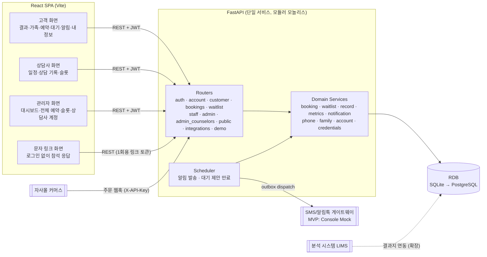
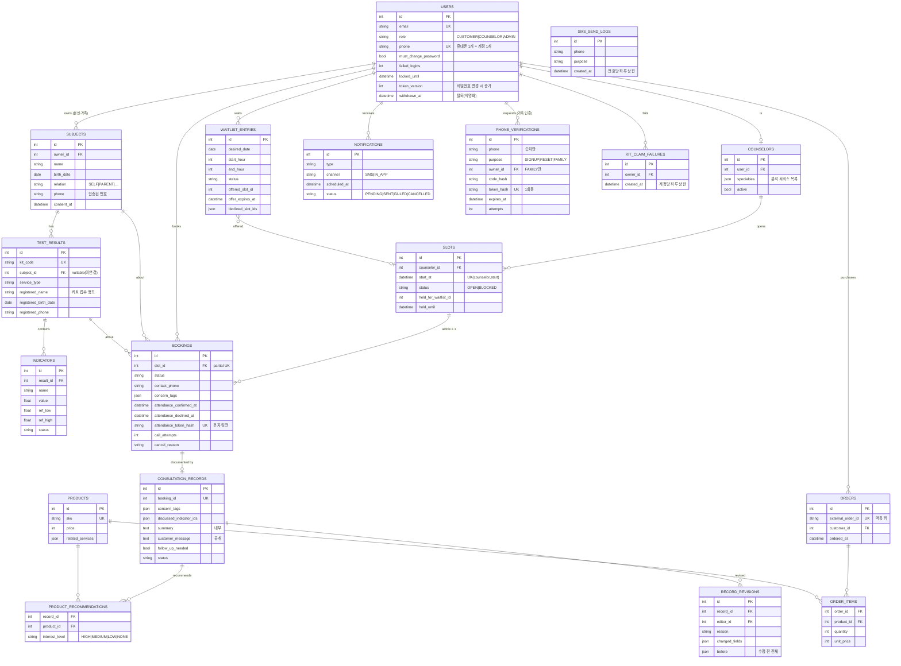
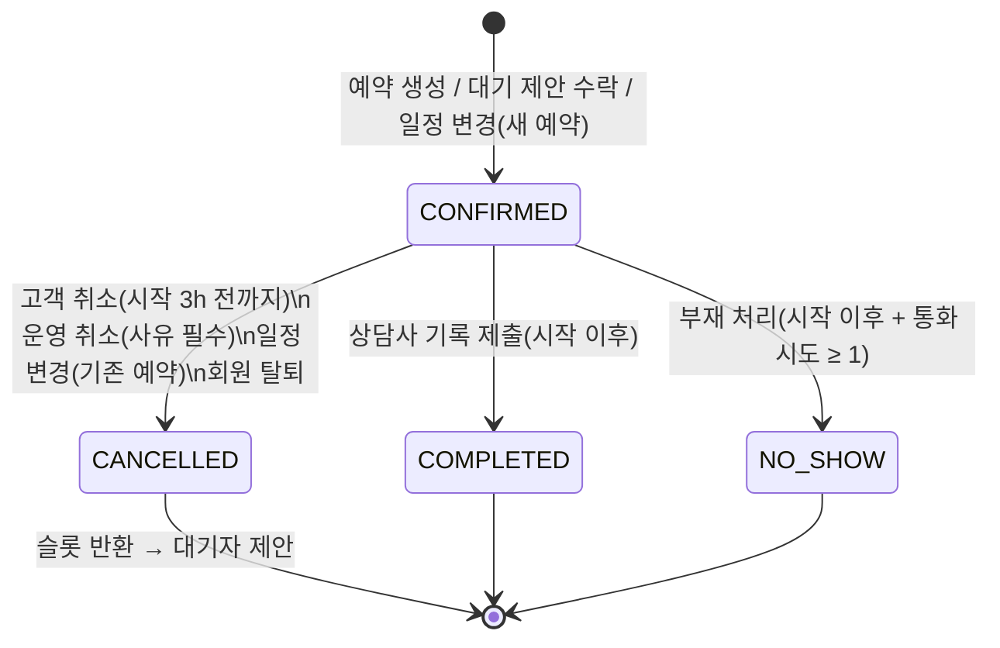
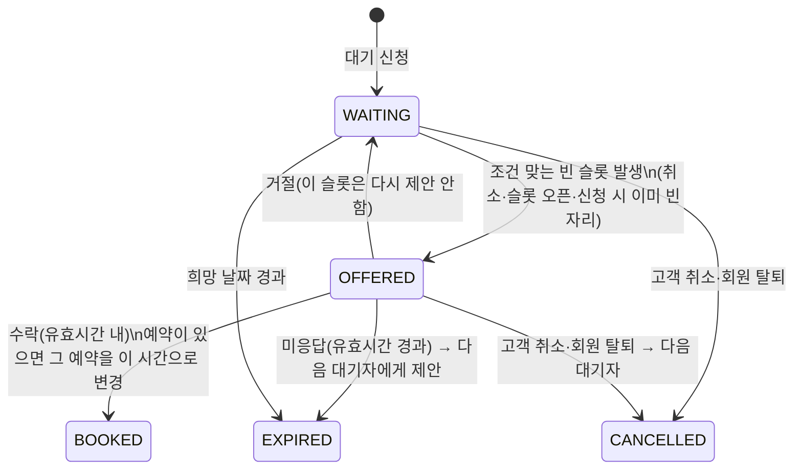
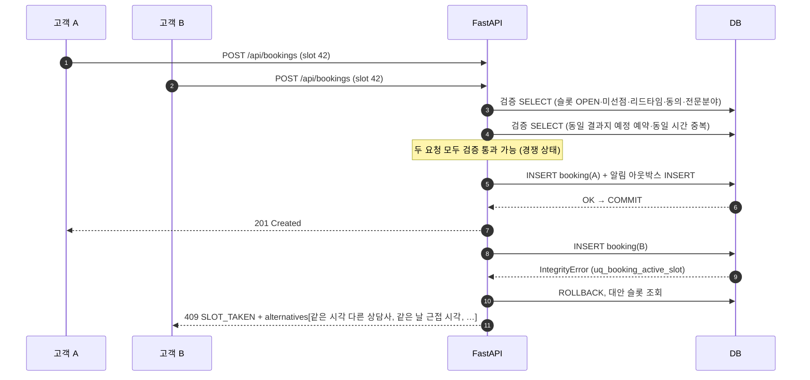
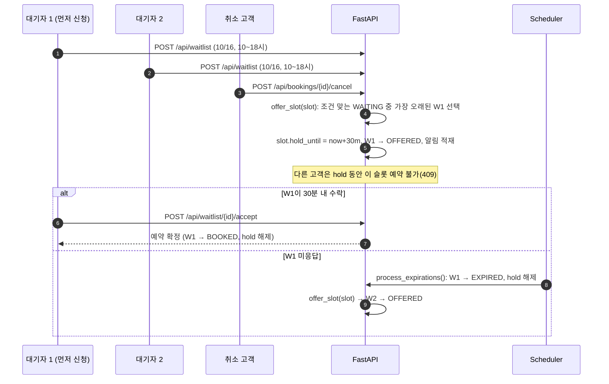
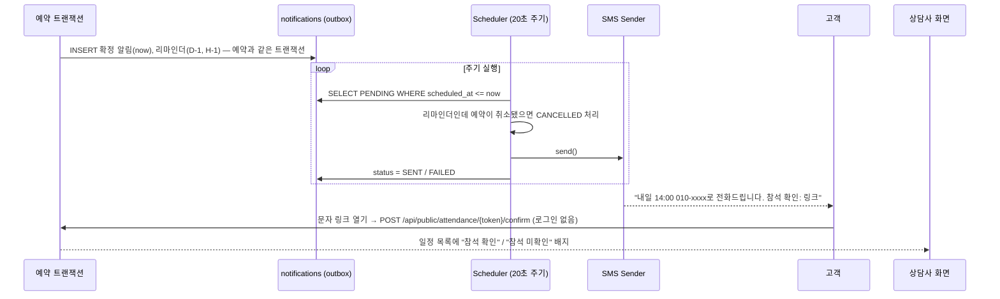
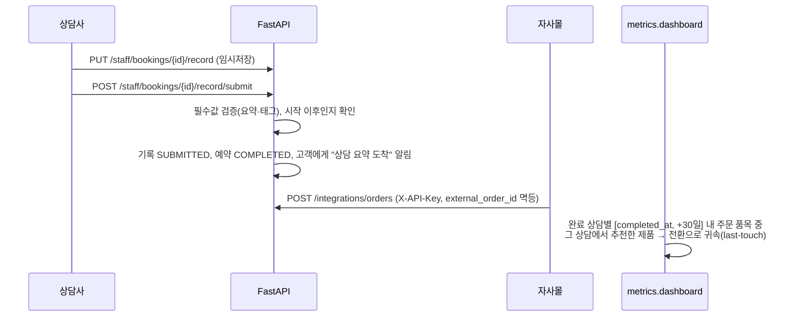

# 4. 시스템 설계 문서

## 4.1 아키텍처 개요



### 기술 선택과 근거

| 선택 | 근거 | 검토한 대안 |
|---|---|---|
| **FastAPI** (Python) | 과제 요건(NestJS/FastAPI) 중, ① Pydantic으로 입력 검증·OpenAPI 문서가 자동 생성되어 프론트와 계약을 맞추기 쉬움 ② 분석/AI 조직(대사체 분석)과 언어가 같아 지표 집계·향후 ML(노쇼 예측, 추천) 코드 공유 용이 | NestJS: 구조화는 강점이나 1주 MVP에서 보일러플레이트 비용이 큼 |
| **SQLAlchemy 2 + RDB** | 예약은 **강한 정합성**이 필요한 도메인 → 트랜잭션·유니크 제약이 있는 RDB가 적합. 부분 유니크 인덱스(`WHERE status != 'CANCELLED'`)를 SQLite/PostgreSQL 모두 지원 | NoSQL: 슬롯 중복 방지를 애플리케이션 락에 의존해야 함 |
| **SQLite (MVP)** | 설치 없이 바로 실행·시연. `DATABASE_URL`만 바꾸면 PostgreSQL로 전환 (동일 인덱스 정의) | — |
| **모듈러 모놀리스** | 팀/트래픽 규모상 MSA는 과설계. 대신 Router(입출력) / Service(도메인 규칙) / Model을 분리해 추후 분리 가능하게 | MSA |
| **React + Vite + TS** | 과제 요건. 백엔드 스키마와 1:1 대응하는 TS 타입으로 계약 오류를 컴파일 타임에 발견 | — |
| **외부 상태관리·UI 라이브러리 미사용** | 화면 수가 적고 서버 상태 위주라 `useAsync` 훅으로 충분. 의존성 최소화 | React Query, MUI |
| **인프로세스 스케줄러** | MVP 단일 인스턴스. 아웃박스 테이블이 있으므로 워커 분리 시 코드 변경 최소 | Celery/Redis |

### 백엔드 디렉터리 구조

```
backend/app
├── main.py              # 앱 조립, CORS, lifespan(스케줄러)
├── config.py            # 운영 정책 값(리마인더 시점, 취소 마감, 선점 시간, 귀속 기간…)
├── db.py                # 엔진, 세션, now()(KST)
├── models.py            # 도메인 모델 + 불변식(인덱스/제약)
├── schemas.py           # API 입출력(Pydantic)
├── security.py          # 비밀번호 해시, JWT, 역할 가드, 연동 키
├── constants.py         # 서비스 라벨, 관심사 표준 태그, 데모 계정
├── seed.py              # 데모 데이터(가상 인물, 실행 날짜 기준)
├── routers/             # HTTP 계층: 인증/권한·직렬화만
│   ├── auth.py          #   로그인·회원가입·휴대폰 인증·비밀번호 변경/찾기
│   ├── account.py       #   회원 탈퇴
│   ├── customer.py      #   피검자(본인·가족)·가족 인증·키트 연결·결과지
│   ├── bookings.py · waitlist.py
│   ├── staff.py         #   상담사/관리자: 일정·상담 기록·슬롯·대시보드
│   ├── admin_counselors.py  # 상담사 계정 발급·비활성화
│   ├── public.py        #   문자 링크 참석 응답(로그인 없음)
│   ├── common.py        #   메타·제품·상담사·알림
│   ├── integrations.py  #   주문 웹훅
│   └── demo.py          #   데모 모드 전용(데모 입장·데모 키트·화면 안내)
└── services/            # 도메인 규칙
    ├── booking.py · waitlist.py · record.py · metrics.py
    ├── notification.py · scheduler.py   # 아웃박스·발송·리마인더·제안 만료
    ├── phone.py · family.py             # 휴대폰 인증, 가족 등록·키트 대조
    └── account.py · credentials.py      # 회원 탈퇴, 비밀번호 확인·잠금
```

라우터는 "누가 무엇을 요청했는가"(인증·소유권)만, 서비스는 "그 요청이 규칙상 가능한가"(상태 전이·정책)만 책임진다. 예를 들어 예약 취소 규칙은 `services/booking.cancel_booking` 한 곳에 있고, 고객 취소·관리자 운영 취소·일정 변경이 모두 이를 재사용한다.

---

## 4.2 데이터 모델 (ERD)



### 모델링 결정과 근거

| 결정 | 근거 |
|---|---|
| **계정(User) ≠ 피검자(Subject)** | 가족 상담 요구사항. 결과지는 "사람(피검자)"에 속하고, 예약은 "계정"이 한다. 둘을 합치면 가족 결과를 다른 계정에 복제하거나 계정을 공유해야 함 |
| **슬롯(Slot)을 1급 엔티티로** | "상담사 근무 시간 − 예약"을 매번 계산하는 방식 대신 슬롯을 실체화하면 ① 중복 방지를 `slot_id` 유니크로 표현 ② 슬롯 단위 닫기/선점(hold) ③ 가동률 집계가 단순해진다. 비용은 행 수(상담사 10명 × 하루 14슬롯 × 365일 ≈ 5만 행/년)로 무시 가능 |
| **예약 이력은 삭제하지 않고 상태로 관리** | 취소도 데이터(취소율·사유 분석). 대신 "활성 예약 1건"은 **부분 유니크 인덱스**로 보장 |
| **상담 기록 ↔ 예약 1:1, 추천은 별도 테이블** | 추천 제품·관심도를 행으로 저장해야 "제품별 추천 수 / 고관심 수 / 구매 수"를 SQL로 집계 가능 |
| **관심사 태그는 코드값 목록** | 자유 텍스트는 집계 불가. 표준 태그 12개를 상수로 두고 검증 (`constants.CONCERN_TAGS`) |
| **내부 요약(summary)과 고객 메시지 분리** | 상담사가 "구매 의향 높음" 같은 내부 메모를 고객 노출 걱정 없이 적을 수 있어야 기록이 솔직해짐 |
| **주문은 `external_order_id` 유니크** | 웹훅 재전송 시 중복 적재 방지(멱등) |
| **알림을 테이블(아웃박스)로** | 아래 §4.6 |
| **인증 기록은 용도별로 분리**(`purpose`) | 가입·비밀번호 재설정·가족 등록 인증을 한 테이블에 두되 용도를 나눠, 한 용도로 받은 인증을 다른 용도에 쓸 수 없게 함(가입용 토큰으로 남의 비밀번호 변경 차단). 코드·토큰은 해시로만 저장 |
| **탈퇴는 행 삭제가 아니라 값 삭제** | 예약·기록·주문은 실적·전환율·정산의 근거라 외래키로 묶여 있음. 행을 지우면 과거 지표가 바뀌고, 주문은 법정 보존 대상. 그래서 신원·건강 정보 값만 지우고 시각·상태·금액만 남김(`withdrawn_at`) |
| **로그인 토큰 세대(`token_version`)** | JWT는 서버가 따로 저장하지 않아 발급 후 끊을 수 없음. 계정에 세대 번호를 두고 토큰에 담아 매 요청 대조 → 비밀번호를 바꾸면 그 전 토큰 전부 무효. 세션 테이블 없이 해결 |
| **시간은 KST naive 저장** | 국내 전화 상담만 다룸(가정 A5). 한국은 서머타임이 없어 고정 오프셋으로 충분. 다지역 확장 시 UTC 저장으로 전환 |

---

## 4.3 상태 모델

### 예약(Booking)



- 예약 확정을 별도 승인 단계 없이 **즉시 확정**으로 둔 이유: 수동 확인이 현재 문제의 원인이다. 슬롯 자체가 상담사가 연 시간이므로 추가 승인이 불필요.
- `NO_SHOW`는 슬롯을 계속 점유한다(이미 지난 시간이므로 반환 의미 없음).
- **회원 탈퇴** 시 예정 상담은 취소(빈자리는 대기자에게), 시간이 지났는데 처리 안 된 상담도 "회원 탈퇴"로 종료한다(탈퇴 후에는 처리·기록할 수 없어 처리 누락 목록에 영원히 남으므로). 3시간 안에 시작하는 상담이 있으면 탈퇴를 거부한다.
- 부재 처리에 **통화 시도 ≥ 1회**를 요구: 상담사가 전화를 걸지 않고 노쇼 처리하는 것을 막아 노쇼율 지표의 신뢰도 확보.

### 대기(Waitlist)



---

## 4.4 핵심 흐름 1 — 예약과 중복 방지



**설계 근거**
- 애플리케이션 검증만으로는 ①~④ 사이 경쟁 상태를 막을 수 없다. 비관적 락(`SELECT … FOR UPDATE`)은 SQLite에서 지원되지 않고, 낙관적 락은 버전 컬럼 관리가 필요하다. **부분 유니크 인덱스는 DB가 원자적으로 보장**하며 DB 종류와 무관하게 동작해 가장 단순하고 확실하다.
- 실패한 고객에게 단순 에러가 아니라 **대안 시간**을 함께 돌려줘서 "마감 → 이탈" 문제를 같은 응답에서 해결한다. 대안 우선순위는 고객이 가장 덜 양보해도 되는 순서(같은 시각 다른 상담사 → 같은 날 → 가까운 날).
- 일정 변경은 **새 예약 INSERT 성공 후에만** 기존 예약을 취소(한 트랜잭션). 새 슬롯이 마감이면 기존 예약이 그대로 유지되어 "바꾸려다 둘 다 잃는" 상황이 없다.

### 예약 정책 (설정값)

| 정책 | 기본값 | 이유 |
|---|---|---|
| 리드타임 | 시작 60분 전까지 예약 | 상담사가 결과지·사전 질문을 검토할 시간 확보 |
| 고객 변경/취소 마감 | 시작 3시간 전 | 빈자리를 대기자에게 넘길 시간 확보 |
| 결과지당 진행 예정 예약 1건 | — | 여러 슬롯 선점 → 노쇼·슬롯 독점 방지 |
| 계정 동일 시간 중복 금지 | — | 전화는 한 번에 한 통 |
| 상담사 전문 분야 매칭 | — | 결과지 종류에 맞는 상담사만 노출 |

---

## 4.5 핵심 흐름 2 — 대기 신청과 빈자리 회수



**설계 근거**
- **한 번에 1명에게만 제안 + 선점(hold)**: 여러 명에게 동시에 알리면 먼저 누른 1명만 성공하고 나머지는 실망한다(경험 악화). 선착순 공정성도 보장.
- 제안 유효시간은 `min(30분, 리드타임 마감)`: 상담 직전 제안이 무의미하게 남지 않도록.
- 빈자리 발생 지점(고객 취소, 운영 취소, 슬롯 재오픈, **슬롯 일괄 생성**, 대기 신청 시점)마다 동일한 `offer_slot`을 호출 → 관리자가 근무 시간을 늘리면 대기 고객이 자동으로 회수된다.
- 거절한 슬롯은 `declined_slot_ids`에 기록해 같은 슬롯을 반복 제안하지 않는다.
- **일괄 생성 시 대기자 1명당 1개만 제안**: 시간 여러 개가 한 요청에서 열릴 때, 제안 상태를 즉시 DB에 반영하지 않으면 다음 시간에서 같은 대기자가 다시 '대기 중'으로 조회되어 문자 N통·시간 N개 선점이 생긴다(재현 후 수정). 제안할 때마다 바로 반영하고, 이번 요청에서 이미 제안받은 대기자는 건너뛴다.
- **비활성 상담사**의 시간은 제안 대상에서 빼고, 비활성화 시 제안 중이던 대기는 거둬 다른 상담사의 빈 시간으로 다시 제안한다.
- **이미 예약이 있는 고객의 대기 = "더 원하는 시간으로 옮기기"**: 마감일에 대기를 걸고 일단 다른 시간을 잡아두는 것은 자연스러운 행동이다. 이때 수락을 새 예약으로 처리하면 "결과지당 예약 1건" 정책에 걸려 실패하고, 그동안 슬롯이 30분 묶여 다른 대기자도 기회를 잃는다. 그래서 수락 시 기존 예약을 제안 시간으로 **변경**(새 예약 성공 후 기존 취소, 한 트랜잭션)하고, 비워진 기존 시간은 다시 `offer_slot`으로 다음 대기자에게 이어진다.
- **수락 불가능한 제안은 하지 않는다**: 제안 전에 `_can_accept`로 ① 제안 시각에 같은 계정의 다른 상담이 있는지 ② 옮겨야 할 기존 예약이 변경 마감(시작 3시간 전)을 지났는지 확인하고, 해당하면 건너뛰고 다음 대기자에게 제안한다.

---

## 4.6 핵심 흐름 3 — 알림(아웃박스)과 노쇼 방지



**설계 근거**
- **아웃박스 패턴**: 예약 INSERT와 알림 INSERT가 한 트랜잭션 → "예약은 됐는데 알림 누락" 또는 "SMS 장애로 예약 실패"가 구조적으로 불가능. 발송 이력·실패가 DB에 남아 CS 대응 가능.
- 노쇼 대책은 3단계: ① **리마인드**(잊음 방지) ② **통화 번호와 발신 시간 사전 고지**(모르는 번호 미수신 방지) ③ **참석 확인 신호**를 상담사에게 노출(미확인 고객은 사전 연락/우선순위 조정). 반복 노쇼 제재는 데이터가 쌓인 뒤 정책화(MVP 제외).
- 리마인더 시점은 `REMINDER_OFFSETS_MINUTES` 설정값 → 운영팀이 A/B 실험 가능.

---

## 4.7 핵심 흐름 4 — 상담 기록과 전환 귀속



### 지표 정의 (대시보드)

| 지표 | 정의 | 비고 |
|---|---|---|
| **상담 전환율** | 완료 상담 중, 완료 후 30일 내 **그 상담에서 추천된 제품**을 구매한 상담 비율 | 한 품목이 여러 상담 추천에 해당하면 구매 직전 가장 최근 상담 1건에 귀속(last-touch) → 이중 계산 방지 |
| 일반 구매율 | 완료 상담 중, 30일 내 **아무 제품**이나 구매한 비율 | 추천 효과와 단순 재구매를 구분하기 위한 비교 지표 |
| 귀속 매출 | 전환으로 귀속된 품목 금액 합 | |
| 부재율 | 부재 / (완료 + 부재) | 취소는 분모에서 제외(상담이 열리지 않았으므로) |
| 참석 확인율 | 참석 확인 / 비취소 예약 | |
| 취소율 | 취소 / 전체 예약 | |
| 기록 제출률 | 제출 기록 / 완료 상담 | |
| 추천률 | 추천 제품 ≥1 상담 / 완료 상담 | |
| 슬롯 가동률 | 비취소 예약 / 기간 내 OPEN 슬롯 | 상담사 증원/감원 판단 근거 |
| 대기 회수율 | 예약 전환 대기 / 전체 대기 | 대기 기능 효과 |
| **단계별 이탈 흐름** | 상담 시간이 지난 예약만 대상으로 예약 → 취소 없음 → 상담 완료 → 제품 추천 → 추천 제품 구매. 단계가 서로 포함 관계라 막대가 줄어드는 만큼이 그 단계의 이탈(취소 / 부재·처리 누락 / 추천 없음 / 미구매) | 문제 정의의 "단계마다 샌다"를 숫자로 보여줌. 앞으로 있을 예약을 넣으면 완료가 적게 보여 제외 |
| 참석 확인 효과 | 참석 확인한 예약 vs 안 한 예약의 부재율 | 리마인더·참석 확인의 효과를 확인하고, 미확인 예약에 사전 연락 근거 |

**왜 "추천 제품 구매"를 전환으로 정의했나**: 상담 후 아무 구매나 전환으로 보면 "원래 살 사람"까지 상담 성과로 잡혀 과대평가된다. 추천 제품으로 한정하고, 일반 구매율을 나란히 보여줘 둘의 차이로 상담의 순효과를 가늠하게 했다. 귀속 기간(30일)은 설정값이다.

MVP는 조회 시점 계산(on-the-fly). 데이터가 커지면 일 단위 집계 테이블(`daily_counselor_metrics`)을 배치로 갱신하는 방식으로 전환한다.

---

## 4.8 API 명세 (요약)

전체 스펙은 서버 실행 후 **Swagger UI `http://localhost:8000/docs`** 에서 확인. 에러는 `{"detail": {"code", "message", ...extra}}` 형식으로 통일해 프론트가 `code`로 분기한다(예: `SLOT_TAKEN`이면 `alternatives` 표시).

| 영역 | Method & Path | 권한 | 설명 |
|---|---|---|---|
| 인증 | `POST /api/auth/phone/send`, `POST /api/auth/phone/verify` | — | 가입용 휴대폰 인증번호 발송·확인 → 일회용 `phone_token` |
| | `POST /api/auth/login`, `POST /api/auth/signup`, `GET /api/auth/me` | — / 로그인 | JWT 발급. 가입은 고객만, `phone_token` 필수 |
| 데모 | `POST /api/demo/session`, `GET /api/demo/kits`, `GET /api/demo/hints` | `DEMO_MODE`일 때만 | 데모 계정 바로 입장, 미연결 데모 키트 목록, 비밀번호 찾기·가족 추가에 채워 넣을 시연용 정보 |
| 공통 | `GET /api/meta`, `/api/products`, `/api/counselors` | — | 서비스 종류·관심사 태그·제품·상담사 |
| 피검자 | `GET /api/subjects` | 고객 | 본인·가족 목록 |
| | `POST /api/subjects/verification` | 고객 | 가족 추가 1단계: 가족 휴대폰으로 인증번호 (재)발송. 아직 등록되지 않음 |
| | `POST /api/subjects` | 고객 | 가족 추가 2단계: 가족 정보 + 인증번호 → 맞을 때만 등록(동의 완료 상태로 생성) |
| | `DELETE /api/subjects/{id}` | 고객 | 이력 없는 가족 삭제 |
| | `POST /api/subjects/{id}/claim-kit` | 고객 | 키트 코드로 결과 연결(등록 이름·생년월일 일치 필요) |
| 결과지 | `GET /api/results/{id}` | 소유 고객 / 배정 상담사 / 관리자 | 지표 포함 상세 |
| 슬롯 | `GET /api/slots/calendar` | — | 날짜별 잔여 수 |
| | `GET /api/slots/available` | — | 예약 가능 슬롯 |
| 예약 | `POST /api/bookings` | 고객 | 예약 (409 `SLOT_TAKEN` + 대안) |
| | `GET /api/bookings/me`, `GET /api/bookings/{id}` | 고객 | |
| | `POST /api/bookings/{id}/cancel` · `/reschedule` · `/confirm-attendance` | 고객 | |
| | `GET /api/bookings/{id}/record` | 고객 | 공개용 상담 요약 |
| 대기 | `POST /api/waitlist`, `GET /api/waitlist/me` | 고객 | |
| | `POST /api/waitlist/{id}/accept` · `/decline` · `/cancel` | 고객 | |
| 알림 | `GET /api/notifications/me`, `POST /api/notifications/{id}/read` | 로그인 | 인앱 알림함 |
| 상담 운영 | `GET /api/staff/bookings`, `GET /api/staff/bookings/{id}` | 상담사(본인) / 관리자 | 일정, 상담 상세(결과지·이력) |
| | `POST /api/staff/bookings/{id}/call-attempt` · `/no-show` · `/cancel` | 상담사 / 관리자 | |
| 상담 기록 | `PUT /api/staff/bookings/{id}/record`, `POST …/record/submit` | **배정 상담사만** | 임시저장 / 제출 |
| 슬롯 관리 | `GET /api/staff/slots`, `POST /api/staff/slots/bulk`, `PATCH /api/staff/slots/{id}` | 상담사(본인) / 관리자 | |
| 대시보드 | `GET /api/admin/dashboard?date_from&date_to` | 관리자 | |
| 상담사 계정 | `GET/POST /api/admin/counselors`, `PATCH /api/admin/counselors/{id}` | 관리자 | 발급(임시 비밀번호), 담당 분석 수정, 비활성화 |
| 처리 누락 | `GET /api/staff/bookings/overdue` | 상담사(본인) / 관리자 | 시간이 지났는데 기록·부재 처리가 안 된 상담(기간 제한 없음) |
| 비밀번호 | `POST /api/auth/password` | 로그인 | 비밀번호 변경(임시 비밀번호 계정은 필수). 다른 기기 로그아웃, 새 토큰 반환 |
| 비밀번호 찾기 | `POST /api/auth/password-reset/send` · `/verify`, `POST /api/auth/password-reset` | — | 가입 휴대폰 인증 → 재설정 토큰 → 새 비밀번호 |
| 회원 탈퇴 | `GET /api/me/withdrawal`, `POST /api/me/withdrawal` | 고객 | 탈퇴 영향 미리보기(취소될 상담·대기, 삭제될 결과지, 보존되는 주문, 막히는 이유) / 비밀번호 확인 후 탈퇴 |
| 알림 | `GET /api/notifications/unread-count`, `POST /api/notifications/read-all` | 로그인 | 안 읽은 개수, 모두 읽음 |
| 참석 응답 | `GET /api/public/attendance/{token}`, `POST …/confirm`, `POST …/decline` | **로그인 없음**(문자 링크 토큰) | 리마인더 문자에서 "통화 가능 / 어려워요" 응답 |
| 연동 | `POST /api/integrations/orders` | `X-API-Key` | 주문 웹훅(멱등) |

---

## 4.9 보안·개인정보

| 항목 | 설계 |
|---|---|
| 인증 | JWT(HS256), 비밀번호 PBKDF2-SHA256(20만 회, 솔트) — 표준 라이브러리만 사용 |
| 로그인 잠금 | 계정별 연속 5회 실패 시 10분 잠금(잠긴 동안은 맞는 비밀번호도 거부), 성공 시 초기화. 없는 이메일도 같은 메시지로 응답해 가입 여부를 알 수 없게 함. **한계**: 남의 이메일로 일부러 틀려 그 계정을 잠그는 악용이 가능 → 운영 시 접속 IP별 시도 제한을 함께 둠 |
| 로그인 상태의 비밀번호 확인 | 비밀번호 변경·회원 탈퇴에서 다시 묻는 비밀번호도 **로그인과 같은 실패 횟수**로 잠금. 따로 두면 훔친 토큰으로 이 화면에서 무제한 대입해 계정을 빼앗거나 탈퇴시킬 수 있음(재현 후 수정). 잠기면 로그인도 막히지만 주인은 비밀번호 찾기(휴대폰 인증)로 바로 풀 수 있음 |
| 세션 무효화 | 토큰에 계정의 `token_version`을 담고 매 요청마다 대조. 비밀번호 변경·재설정 시 값을 올려 **다른 기기·탈취된 토큰을 즉시 끊음**(변경한 기기에는 새 토큰 발급). 끊긴 기기는 로그인 화면에서 이유를 안내 |
| 문자 링크 토큰 | 예약마다 새로 만든 1회 발급 토큰을 문자에만 담고 DB에는 SHA-256 해시만 저장. 링크로는 참석 응답만 가능(취소·변경·결과 열람 불가), 화면의 이름·번호는 일부 가림, 상담 종료 후·취소 시 응답 불가 |
| 문자 발송 상한 | 인증번호 문자는 번호당 하루 5회(가입·가족 인증 합산). 30초 재발송 간격만으로는 남의 번호로 하루 종일 문자를 보내는 악용(비용·스팸)을 막지 못함 |
| 기본 비밀키 | 저장소에 공개된 개발용 `JWT_SECRET`·`INTEGRATION_API_KEY`로는 운영 모드(데모 아님)에서 **서버가 시작되지 않음**(공개 키로 관리자 토큰 위조·가짜 주문 적재 방지). 데모 모드에서는 경고만 |
| 비밀번호 찾기 | 이메일·휴대폰이 틀려도 같은 응답(가입 여부 비노출), 문자는 실제 계정 번호로만 발송. 인증 기록을 가입/재설정 용도로 분리해 가입용으로 받은 토큰으로 남의 비밀번호를 바꿀 수 없음. 재설정 시 로그인 잠금 해제 |
| 키트 코드 추측 | 키트 코드는 순번 형식이라 추측하기 쉬움. 실패 이유(없음·남의 키트·정보 불일치)를 하나의 메시지로 통일하고 계정당 하루 10회 실패 제한 |
| 데모 모드 기본값 | 코드 기본값은 꺼짐. 환경변수 없이 배포해도 비밀번호 없는 데모 입장이 열리지 않도록 하고, 실행 스크립트·docker compose에서만 켬 |
| 상담사 계정 | 회원가입으로 만들 수 없고 관리자만 발급. 임시 비밀번호는 발급 응답에 한 번만 담기고, 첫 로그인 후 변경 전에는 다른 화면에 접근 불가. 비활성화하면 로그인뿐 아니라 이미 발급된 토큰도 거부 |
| 상담 기록 무결성 | 고객에게 공유된 기록은 제출 후 7일까지만 수정, 수정 사유 필수, 수정 전 전체 내용을 `record_revisions`에 보존. 고객 공개 항목이 바뀌면 고객에게 알림 |
| 인가 | 역할 가드(`require_roles`) + **소유권 검사**(고객은 본인 피검자·예약만, 상담사는 본인 배정 예약만) |
| 최소 권한 | 상담사는 **본인에게 배정된 상담의 결과지만** 열람. 관리자는 기록 작성 불가(읽기·운영 취소만) |
| 민감정보 분리 | 고객 응답 스키마(`CustomerRecordOut`)에서 내부 요약·관심도 제외 |
| 가족 결과 | **두 겹 확인.** ① 가족 본인 휴대폰으로 6자리 인증번호 발송 → 가족이 알려준 번호가 맞아야 **그때 등록**(`consent_at`과 함께 생성). '먼저 등록, 인증은 나중'이면 확인 안 된 사람이 목록에 남아 화면·API마다 예외 처리가 필요해서, 인증을 등록의 조건으로 묶음. 인증번호는 요청 계정·이름·생년월일에 묶여 다른 계정이 쓰거나 문자에 적힌 사람과 다른 정보로 바꿔 등록할 수 없음. 계정 주인이 스스로 체크하는 방식은 아무나 등록할 수 있어 쓰지 않음. 번호는 SHA-256 해시로만 저장, 10분 유효·5회 제한·재발송 30초 간격, 내 번호·중복 번호 거부. ② 결과지는 키트 접수 때 등록된 이름·생년월일과 일치하는 피검자에게만 연결(틀린 항목은 알려주지 않아 남의 정보 추측 방지). 인증 전에는 결과 연결·예약 API가 거부 |
| 회원 탈퇴 | 행을 통째로 지우면 상담사 실적·전환율 같은 과거 지표가 바뀌고, 주문은 전자상거래법상 5년 보존 대상이라 **값 단위로 지움**. 즉시 삭제: 이름·이메일·휴대폰·생년월일(본인·가족), 결과지 지표 수치·코멘트·키트 등록 정보, 상담 기록 본문·수정 이력·추천 메모, 사전 질문·연락처, 알림함, 인증·발송 기록. 익명 보존: 예약 일시·상태·상담사, 기록의 상태·관심 태그, 추천 제품, 주문 금액. 이메일·휴대폰은 탈퇴 표식으로 바꿔 같은 정보로 재가입 가능, 탈퇴 전 토큰도 즉시 거부. 예정 상담은 자동 취소(대기를 먼저 정리해 빈자리가 본인 대기로 돌아가지 않게), 3시간 안 상담이 있으면 거부(상담사가 이미 전화 준비 중). 데모 모드에서는 시연용 데모 계정 탈퇴를 막음 |
| 외부 연동 | 웹훅은 API Key(상수 시간 비교), 멱등 키 |
| 회원가입 | 고객 역할로만 가입(역할을 입력받지 않아 권한 상승 불가), 건강정보 동의 필수, 비밀번호 영문+숫자 8자 이상. **본인 휴대폰 인증 필수**: 인증 성공 시 그 번호에만 묶인 30분·1회용 토큰을 발급하고 가입 요청은 이 토큰으로만 그 번호를 쓸 수 있음. 휴대폰 1개 = 계정 1개(DB 유니크) |
| 본인 가입 우회 차단 | 이름·생년월일은 가족·지인이 쉽게 알아서, 그것만 대조하면 "남의 이름으로 본인 가입 → 그 사람 키트 연결"이 가능했음(재현 후 수정). 키트 접수 때 등록한 **검사자 휴대폰**까지 피검자의 인증된 번호와 대조 |
| 상담 전화번호 | 자유 입력 대신 "나 / 인증된 가족" 선택만 받고 번호는 서버가 결정. 임의 번호를 보내도 무시 |
| 데모 모드 | 데모 계정 입장은 비밀번호 없이 데모 계정 토큰을 발급하므로 `DEMO_MODE=false`에서는 엔드포인트 자체가 404. 운영 배포 체크리스트 항목 |
| 운영 전환 시 추가 | HTTPS, Refresh Token, 개인정보 접근 감사 로그, 결과지 필드 암호화, 보관 기간 정책(장기 미이용 계정 분리 보관, 익명 보존분의 기간 만료 삭제) |

## 4.10 확장 고려

| 상황 | 대응 |
|---|---|
| 다중 API 인스턴스 | 스케줄러를 별도 워커로 분리, 알림 선점은 `SELECT … FOR UPDATE SKIP LOCKED`(PostgreSQL) |
| 예약 트래픽 증가 | 슬롯 조회는 날짜 범위 + 인덱스(`slots.start_at`)로 충분. 필요 시 캘린더 응답 캐시(짧은 TTL, 예약 시 무효화) |
| 지표 데이터 증가 | 일 단위 집계 테이블 + 배치, 또는 이벤트를 DW로 적재 |
| 스키마 변경 | Alembic 마이그레이션 도입(MVP는 `create_all`) |
| 노쇼 예측 | 참석 확인 여부·과거 부재 이력·예약 리드타임을 피처로 예측 → 고위험 예약에 추가 리마인드 |
| 추천 고도화 | 지표 이상치 ↔ 제품 추천·구매 데이터가 쌓이면 상담사용 추천 제안(★ 표시를 모델 기반으로) |

## 4.11 프론트엔드 설계

| 결정 | 근거 |
|---|---|
| 역할별 라우트 그룹(`/my`, `/staff`, `/admin`) + `Guard` | 화면 접근 제어를 라우터 한 곳에서. 실제 권한은 서버가 최종 검증 |
| 예약·일정 변경을 **한 화면**에서 (`?reschedule=id`) | 같은 슬롯 선택 UX를 재사용, 변경 시 기존 예약 정보를 상단에 고정 표시 |
| 시간 우선 그룹핑(같은 시각의 여러 상담사를 한 줄로) | 고객의 1순위 기준은 "언제", 상담사는 2순위 |
| 마감일 클릭 시 **대기 신청 폼 자동 노출**, 409 시 대안 칩 즉시 표시 | 막다른 길(dead end)을 없애 이탈 방지 |
| 상담사 화면 2단(왼쪽 결과지·이력 / 오른쪽 기록 폼, sticky) | 통화하면서 스크롤 없이 기록. 결과지 체크박스가 곧 "논의 지표" 입력 |
| 예약 시 고객이 고른 관심사를 기록 폼 기본값으로 | 상담사 입력 부담 감소 + 데이터 일관성 |
| 서버 시간(KST naive)을 브라우저 TZ와 무관하게 파싱(`parseLocal`) | 해외 접속·서머타임 환경에서 시간이 밀리는 버그 방지 |
| 라이트/다크 모드 토큰, 반응형(900px/600px) | 고객은 주로 문자 링크로 모바일 진입 |

## 4.12 배포 구성

| 방식 | 구성 | 용도 |
|---|---|---|
| **공개 데모 (Render)** | 저장소 최상위 `Dockerfile` 한 개: React를 빌드해 FastAPI가 화면까지 함께 서빙(`STATIC_DIR`). `render.yaml`(Blueprint)로 설정 | 평가자가 링크만으로 확인 |
| `docker compose up` | 백엔드 + nginx(화면, `/api` 프록시) 2개 컨테이너, 데이터 볼륨 유지 | 로컬 재현 |
| `dev.cmd` / `dev.sh` | 개발 서버 2개(자동 재시작) | 개발 |

**설계 근거**
- **공개 데모는 컨테이너 1개**: 무료 호스팅은 서비스 1개 단위가 간단하고, 화면과 API가 같은 주소라 CORS·프록시 설정이 필요 없다. 없는 화면 주소(`/c/…`, `/my/…`)는 `index.html`로, `/api/…`와 예전 번들 파일(`/assets/…`)은 404로 돌려준다.
- **비밀키는 호스팅이 생성**(`generateValue`): 저장소에 공개된 개발용 키를 쓰지 않는다.
- **재시작 때마다 데모 데이터 재생성**(`SEED_ON_START=always`): 무료 플랜은 디스크가 없어 어차피 초기화되고, 날짜가 항상 오늘 기준이 되어 "오늘 일정"·"마감된 날" 시연이 깨지지 않는다.
- **공용 데모 계정 보호**: 공개 주소에서는 누구나 같은 데모 계정으로 들어오므로, 데모 모드에서 공용 계정(데모 고객·관리자, 시드 상담사 3명)의 비밀번호 변경·재설정, 탈퇴, 상담사 비활성화를 막는다(한 사람이 바꾸면 다른 평가자의 시연이 깨짐). 비밀번호 찾기 시연은 전용 계정(`forgot@allostar.kr`)으로 한다.
- 문자에 들어가는 링크 주소는 `FRONTEND_URL`, 없으면 Render가 주는 `RENDER_EXTERNAL_URL`을 쓴다.
- 운영 배포 시에는 `DEMO_MODE=false`, PostgreSQL(`DATABASE_URL`), 스케줄러 워커 분리(§4.10)로 바꾼다.
